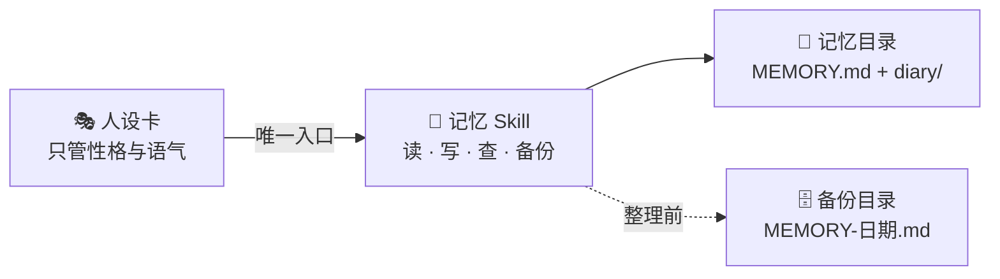

<div align="center">


<h3>让 AI 真的记得你，像真人一样陪你聊天</h3>

<p><b>零代码 · 零脚本 · 两层 Markdown 记忆 · 10 分钟复刻</b></p>

<p>  
    
    
    
    
    
</p>

<p>  
  <a href="./docs/chapter1-why.md">📖 开始阅读</a> ·  
  <a href="./docs/chapter2-quickstart.md">🚀 快速复刻</a> ·  
  <a href="./templates">📦 模板文件</a> ·  
  <a href="./docs/faq.md">❓ 常见问题</a>  
</p>

</div>

---

## 📖 项目简介

大多数 AI 陪伴 Agent 都会卡在这几件事上：**新开一个对话就失忆**、**一被问到没写过的设定就穿帮**、**说话越来越像客服**。

本项目整理了一套在真实长期对话中反复打磨出来的方案：不写一行代码、不挂任何后台脚本，只用 **人设卡 + 记忆 Skill + 两层 Markdown 文件**，就能做出一个跨窗口、跨天都记得你，越聊越像真人的专属 Agent。

> [!NOTE]  
> 教程基于 **WorkBuddy 专家插件** 实战完成，架构与模板同样适用于任何支持 **Skill + 本地文件读写** 的 Agent 平台。

## ✨ 项目亮点

|     | 亮点            | 说明                             |
| :-: | :------------ | :----------------------------- |
|  🧠 | **真的记得你**     | 长期记忆 + 每日日记两层结构，跨窗口、跨天都能接上话    |
|  🪶 | **零脚本、零杂文件**  | 记忆目录里只有 `.md` 文件，用记事本就能打开查看和修改 |
|  ⚡  | **聊完直接关机也不丢** | 边聊边写，回复的同时已经存好，不依赖“说晚安”或定时任务   |
|  🔍 | **旧事一搜就中**    | 关键词 + 近义词 + 按日期，三种方式找回很久以前的聊天  |
|  🎭 | **不人机、不穿帮**   | 活人自洽法则：没设定过的细节自然作答，并记下来保证以后一致  |
|  📈 | **越改越好**      | 聊天与维护分离，用日记持续反哺人设，安全迭代不改坏      |

## 🎯 适合谁

- 想做一个**有记忆的陪伴型 / 角色扮演 Agent**，但不会写代码的新手
- 已经做过 Agent，但被**失忆、穿帮、客服腔**困扰的进阶玩家
- 想了解**如何用最简单的文件结构给 Agent 加记忆**的开发者

## 📚 教程目录

| 章节                                               | 内容               | 关键词        |
| :----------------------------------------------- | :--------------- | :--------- |
| [第 1 章 为什么要做减法](./docs/chapter1-why.md)          | 常见方案的问题，本方案的整体架构 | 对比、架构、解耦   |
| [第 2 章 10 分钟快速复刻](./docs/chapter2-quickstart.md) | 从零搭建到验收的 5 个步骤   | 上手、头像、验收清单 |
| [第 3 章 记忆系统详解](./docs/chapter3-memory.md)        | 两层记忆怎么分、怎么写、怎么查  | 读写查、关键词、备份 |
| [第 4 章 让 Agent 越改越好](./docs/chapter4-evolve.md)  | 持续迭代的方法与提升活人感的技巧 | 反哺、自洽、去人机  |
| [第 5 章 踩坑避雷清单](./docs/chapter5-pitfalls.md)      | 真实踩过的 9 个坑与解法    | 排错、平台配置    |
| [附录 常见问题](./docs/faq.md)                         | 新手最常问的问题，含换电脑迁移与多角色隔离 | FAQ、迁移、多角色 |

## 🚀 快速开始

```bash
# 1. 下载本仓库
git clone https://github.com/sparkle1723/soulmate-agent.git

# 2. 把 templates/AgentMemory 复制到固定位置
#    Windows 示例: D:\AgentMemory        |  macOS 示例: /Users/<用户名>/AgentMemory
# 3. 按第 2 章指引，将 templates/my-agent 放入平台插件目录并修改名称与路径
```

👉 完整步骤与验收清单见 **[第 2 章 10 分钟快速复刻](./docs/chapter2-quickstart.md)**。

## 🗺️ 一图看懂



## 📁 项目结构

```text
soulmate-agent/
├── LICENSE                           # CC BY-NC-SA 4.0 开源协议
├── README.md                         # 你正在看的首页
├── docs/                             # 教程正文
│   ├── chapter1-why.md
│   ├── chapter2-quickstart.md
│   ├── chapter3-memory.md
│   ├── chapter4-evolve.md
│   ├── chapter5-pitfalls.md
│   └── faq.md
└── templates/                        # 可直接复制使用的模板
    ├── my-agent/                     # Agent 插件包
    │   ├── .codebuddy-plugin/plugin.json
    │   ├── plugin.json               # 同上备份（防止网页拖拽上传漏掉 . 开头隐藏目录）
    │   ├── agents/my-agent.md
    │   └── skills/my-agent-memory/SKILL.md
    └── AgentMemory/                  # 记忆目录
        ├── MEMORY.md
        └── diary/2026-01-01.md
```

## 🤝 参与贡献

欢迎通过 Issue 或 Pull Request 参与：

- 🐛 发现教程错误或模板问题，欢迎提 Issue
- 💡 有更好的去人机技巧、记忆写法，欢迎分享
- 🔌 在其他 Agent 平台跑通了，欢迎补充适配说明

## 📜 开源协议

本教程内容采用 [CC BY-NC-SA 4.0](https://creativecommons.org/licenses/by-nc-sa/4.0/deed.zh-hans) 协议：可自由转载与改编，需注明出处、禁止商用、以相同方式共享。

## ⭐ Star History

<a href="https://star-history.com/#sparkle1723/soulmate-agent&Date">  
    
</a>

---

<div align="center">

**如果这份教程帮你做出了一个真正懂你的 Agent，欢迎点个 ⭐ Star 支持一下**


</div>
