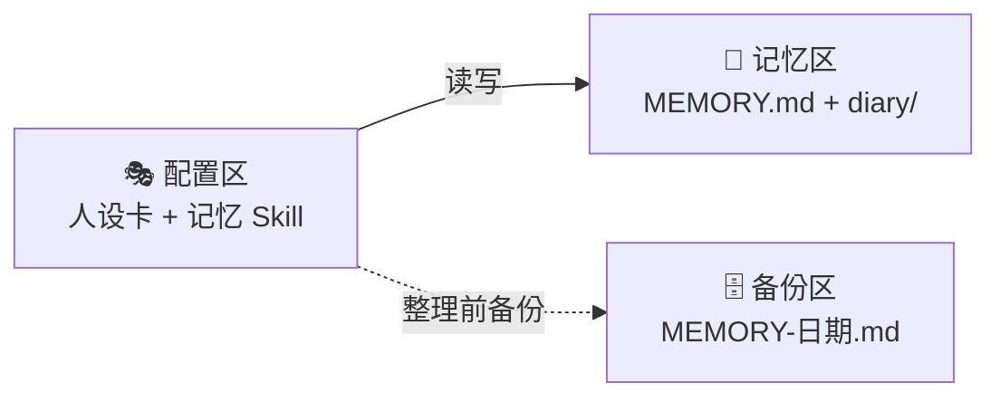

[🏠 返回首页](../README.md)

# 第 1 章 为什么要做减法

> **本章你将了解**：常见陪伴 Agent 方案的问题在哪，以及本方案的整体架构。

---

## 1.1 常见方案的三种问题

| 常见做法 | 遇到的问题 | 本方案的做法 |
| :--- | :--- | :--- |
| 只写一段提示词 | 每次新开对话就失忆 | 固定目录的两层 Markdown 记忆，跨窗口、跨天都记得 |
| 堆脚本 + 数据库 + 定时任务 | 文件夹一团乱，脚本报错就出戏 | 零脚本、零日志，记事本就能打开看和改 |
| 说“晚安”才保存记忆 | 聊完直接关机，当天全丢 | 边聊边写，回复的同时已经存好 |
| 设定里没写的就硬圆场 | “要不就定在某天吧”，瞬间穿帮 | 活人自洽法则：自然作答，并记下来保证以后一致 |

## 1.2 为什么“复杂”反而更糟

我最初的版本有三层记忆、四个 Python 脚本、跨进程锁、运行日志、夜间定时整理和 Git 自动推送。用下来发现三个问题：

1. **看不懂**：记忆目录里堆满 `.log`、`.lock`、`.jsonl`，分不清哪些是记忆、哪些是杂物
2. **更出戏**：Agent 每次都要拼一长串命令去跑脚本，很容易从“聊天人格”掉回“代码助手”
3. **不防关机**：电脑关着时定时任务同样跑不了，反而留下一堆积压的中间文件

> [!IMPORTANT]
> 现在的 Agent 本身就能稳定地读写文件和全文搜索。**删掉所有脚本，只留 Markdown 文件**，维护成本降到零，对话也明显更自然。

## 1.3 整体架构：三个区域互不干扰

| 区域 | 放什么 | 设计原则 |
| :--- | :--- | :--- |
| **配置区** | 人设卡、记忆 Skill、名片配置 | 人设卡里不写记忆路径，记忆操作全部交给 Skill |
| **记忆区** | `MEMORY.md` 和 `diary\` | 使用**固定绝对路径**，不跟随工作区变化 |
| **备份区** | 整理长期记忆前的旧版 | 放在记忆区**外面**，避免搜索时误命中 |

## 1.4 本方案的六个优点

1. **极简**：只有 `.md` 文件，零维护
2. **更像真人**：不跑命令行，模型注意力全在聊天上
3. **不丢记忆**：边聊边写，直接关机也不怕
4. **找得到**：关键词、近义词、日期三种检索
5. **安全**：Agent 不能改自己的配置，聊天与维护分离
6. **可回溯**：精简长期记忆前自动备份

---

| [🏠 首页](../README.md) | [下一章：10 分钟快速复刻 ➡️](./chapter2-quickstart.md) |
| :--- | ---: |
