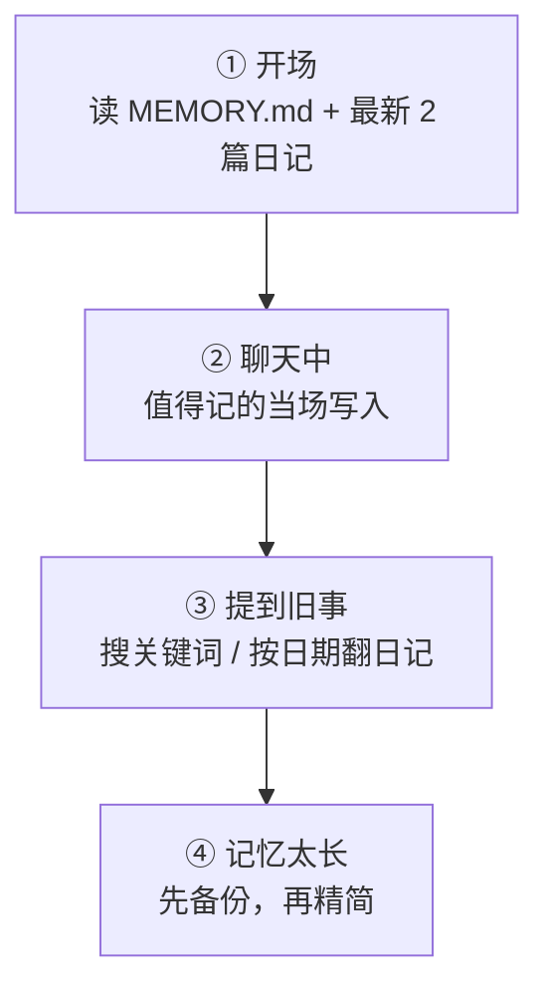

[🏠 返回首页](../README.md)

# 第 3 章 记忆系统详解

> **本章你将了解**：两层记忆怎么分工、一次对话中记忆如何流转、怎样写才能被搜到。

---

## 3.1 两层记忆的分工

> **判断标准只有一句：过一个月后，这件事每次聊天还用得上吗？**
>
> 用得上 → `MEMORY.md`　　只是今天的事 → `diary\`

| | 📘 长期记忆 `MEMORY.md` | 📗 每日日记 `diary\YYYY-MM-DD.md` |
| :--- | :--- | :--- |
| **作用** | 认识“你”和“她”是谁 | 记录今天发生了什么 |
| **何时读** | 每次开场**全篇必读** | 开场只读**最新 2 篇** |
| **写什么** | 喜好、约定、雷点、里程碑、近期状态、她自己的生活细节 | 当天的事件、情绪、趣事 |
| **怎么写** | 1~2 句结论；同类合并；过时直接**覆盖** | 按时间追加；同一天多个窗口写进**同一篇** |

### 什么该记，什么不记

| ✅ 该记 | ❌ 不记 |
| :--- | :--- |
| 对方的事实与喜好 | 寒暄（早安 / 嗯嗯 / 哈哈） |
| 情绪波动与重要事件 | 一次性查询（今天几度、翻译一句话） |
| 承诺、约定、雷点 | 已经记过且没变化的内容 |
| 没聊完的话题 | |

## 3.2 一次对话中的记忆流转



### ① 开场：读什么

每次新对话只固定读 **5 个文件**：

| 文件 | 由谁加载 |
| :--- | :--- |
| 人设卡 `agents/my-agent.md` | 平台自动加载 |
| 记忆规则 `SKILL.md` | 平台自动加载 |
| `MEMORY.md` | 记忆 Skill |
| 最新 2 篇日记 | 记忆 Skill |

更早的日记平时不读，只有提到时才去搜，所以聊得再久也不会变慢。

### ② 写入：为什么要“边聊边写”

如果等到“晚安”才写日记，聊完直接关机就会丢。所以规则是：**当轮聊到值得记的内容，回复的同时就写进文件**，散场时只补漏，不重复写。

### ③ 查找：三种方式

| 方式 | 适用场景 | 示例 |
| :--- | :--- | :--- |
| 关键词 | 提到某件具体的事 | “上次打球赢了” → 搜“打球” |
| 近义词 | 第一次没搜到 | “打球”没中 → 换“比赛”“运动” |
| 按日期 | 提到模糊时间 | “十月份聊过啥” → 翻 `diary\2026-10-*.md` |

真的没搜到时，**不硬编、不说“未检索到”**，像真人一样问一句“诶我一下没想起来，你提醒我一下嘛”，听完再补记。

### ④ 瘦身：长期记忆太长怎么办

当 `MEMORY.md` 超过 **200 行**：

1. 先列出精简方案给你确认：删掉过时的近期状态、合并同类条目、长故事缩成一两句
2. 确认后，**先把旧版完整复制**到 `D:\AgentMemory-backups\MEMORY-YYYY-MM-DD.md`
3. 再更新 `MEMORY.md`

## 3.3 记录格式

格式决定了以后能不能被找到。

```markdown
<!-- MEMORY.md：一句结论 + 日期 -->
- 饮品：超爱喝生椰拿铁（2026-11-22）

<!-- diary/2026-11-22.md：时间 + 经过 + 关键词 -->
- **20:30** 慢投垒球比赛打赢了，超开心。（关键词：打球、棒垒球、比赛、运动）
```

> [!IMPORTANT]
> 日记末尾的**大白话关键词**是整个检索的关键。正文写的是“慢投垒球”，你问“打球”时就靠它命中。

## 3.4 常见疑问

| 问题 | 答案 |
| :--- | :--- |
| 同一天在不同窗口聊，会分成几个文件吗？ | 不会，都追加到当天同一篇日记 |
| 两层记忆会不会内容重复？ | 不会。`MEMORY.md` 只存结论，`diary\` 存经过 |
| 信息有更正怎么办？ | 直接覆盖 `MEMORY.md` 的旧条目，日记保留原样 |

---

| [⬅️ 上一章：10 分钟快速复刻](./chapter2-quickstart.md) | [下一章：让 Agent 越改越好 ➡️](./chapter4-evolve.md) |
| :--- | ---: |
